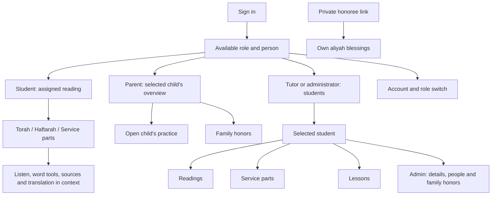

# A clearer product structure

Consultant recommendation • 18 October 2026 • Proposed experience, not an approved implementation specification.

Daniel prefers reorganizing the existing features into clearer journeys. The organizing principle should be **the person you are helping and the task you are doing**. A user should not need to know which subsystem stores a reading, invitation, lesson or honor.

## What “easy for an ordinary iPhone user” means

Someone can use familiar lists, buttons, pickers and back navigation without memorizing reference syntax, interpreting internal status codes or receiving a tour. This does not mean eliminating meaningful Jewish terminology, flattening permissions, or making every administrative task fit into one tap.

The product should answer four questions on every working screen: whose information is this, what can I do here, what should I do next, and did my change save? Detail belongs at the moment it helps answer one of those questions.

Retain the existing reading interface and the working agreement's clear Hebrew, restrained color and practice tools beside it; introduce no childish rewards or new decorative system. Improve the structure before another visual redesign.

## Recommended navigation

These are navigation concepts, not route names or a request to add every proposed destination immediately. A destination appears only when its permitted, usable content exists.

| Audience | Default arrival | Main navigation | Contextual or secondary |
| --- | --- | --- | --- |
| Student, child or adult | Assigned reading, immediately | Torah, Haftarah, Service parts, when assigned | Word/verse tools, practice history, account, print when available |
| Parent | Selected child's overview; a clear child picker for multiple children | Overview, Family honors; prominent Open practice action | Lesson notes and reading summary within Overview; return from child practice |
| Tutor | Assigned students, then the student's Reading | Reading, Service parts, Lessons | Student switcher; permitted source and assignment changes within the relevant passage |
| Administrator | Searchable Students list | Students; secondary People, Invitations, Imports, Settings when available | Within a student: summary, Reading, Service parts, Lessons, Family honors, People and access |
| Honoree | Their own before/after blessings | Before and After, within one scoped page | Required credits and simple link-expiry/reopening guidance |
| Office reader | Owned roster Sheet when operational | Familiar Sheet layout | No new portal role or duplicate administrative workspace |

Avoid a universal bottom bar containing everything. Student practice and administrative work have different priorities. Use a small, stable set of destinations for each role; keep the selected child/student visible above them. On a phone, a labeled “More” menu may hold occasional actions, but should never hide the primary action or selected identity. On a laptop, the same destinations can use more space without changing meaning.

A student should not land on an extra overview page. An administrator benefits from a compact student summary showing factual readiness—date and service, readings assigned, tutor assigned, access pending—because their next task varies. This summary must link to the incomplete task and must not invent a percentage-complete score.

## Flagship journey: assign Torah or haftarah

The current deployed workflow exposes several choices about how to make an assignment before helping choose the assignment itself. A separate, undeployed reading-editor checkpoint improves date suggestions and selectors; it is useful evidence, but does not establish that the full journey is solved.

**Recommended path:** open student → choose Torah or Haftarah → use the existing date and service to suggest the reading → choose verses → review the result → save the assignment.

| Moment | What the person sees | Product behavior and exception |
| --- | --- | --- |
| Begin | Student, ceremony date and named service; current assignment if present | Reuse saved context. Ask for date/service only when missing or ambiguous. Do not ask users to re-enter known information. |
| Choose reading | “Suggested for this service” with the portion name and reason; “Choose another reading” | Morning and afternoon/Havdalah rules must be reflected honestly. Holiday/uncertain cases require an explicit choice; never make a confident but unverified suggestion. |
| Choose passage | A familiar searchable list of portions/books and a visible passage preview | Prefer recognition over entering syntax. Search supports familiar spellings where possible, without requiring a perfect transliteration. Custom book/chapter/verse choice stays available. |
| Choose verses | Whole portion preview; clear start and end controls; selected verse count | Custom verse selection is primary. Full/triennial helpers are optional shortcuts. Typical verse counts are guidance, never hard caps. Multi-range selections remain possible under “Add another passage.” |
| Divide Torah | Optional “Divide into aliyot” after a passage has been chosen | Explain the consequence for family honors. Do not mix reading extent and aliyah boundaries into one unclear form. Haftarah does not inherit Torah-only controls. |
| Review | Plain summary: kind, passage, verse count, ceremony context, divisions and what is replacing the old assignment | One consequential review is justified. Internal preparation and validation should not appear as separate user tasks. Preserve server verification and explicit confirmation. |
| Finish | Saved assignment visible in the student's Reading; clear next action | Distinguish preview, unsaved selection and saved assignment. A date change later flags the existing assignment for review; it must not silently replace the reading. |

Useful example labels: “Suggested for this service,” “Choose verses,” “Add another passage,” “Divide into aliyot,” “Review assignment,” “Save assignment.” These are proposed copy, not a direction to replace every control with these words regardless of state.

## Complete journeys beyond the reading editor

### Set up a student and make the account usable

Create the student's record using essential information first. Then show the saved student and the next unfinished steps: readings, tutor, family/student access. Saving a contact must say that the contact was saved; it must not imply an invitation was sent.

Keep people management available globally for bulk administration, but let the administrator start an invitation from the student's People and access area with the student and intended relationship already clear. Before granting access, summarize **who will see which student's information and in what role**. After sending, distinguish pending invitation from accepted access. Keep removal of one relationship distinct from revoking a person's congregation role.

The product should help the administrator finish setup without requiring them to discover and connect several unrelated management screens. This is a continuity recommendation, not automatic role assignment or automatic mail.

### Practice and study

The reading remains the center. Give the principal listening action a specific label and visible availability; establish a simple entry point to hear a verse, repeat it and return to the passage. Word tools should explain a selected word without forcing a separate learning mode. Sources, translation drafts and teacher notes belong with their verse, with detail progressively revealed.

Keep optional depth genuinely optional: a learner should be able to practice without opening grammar, calendars, metadata or a source browser. Conversely, learners who need those tools must be able to find them in predictable locations. Keep both Torah and haftarah easy to reach. Required attribution remains accessible, even when technical details recede.

Teacher assessments and student self-checks need distinct names and attribution. “Got it” must not look like a teacher signed off. Quiet practice history supports reflection; it should not compete with the passage or become a reward system.

When audio or a translation is unavailable, preserve the usable text and explain the specific limitation. Do not show a large inert promise as the main practice action. The proposed normal audio journey depends on the existing separate student-release acceptance.

### Teach a lesson

A tutor opens a student, sees the same passage identifiers the student sees, and can move between Reading, Service parts and Lessons without losing that student. Assignment and source changes start where their results will be used. Adding a lesson summary should return a visible saved note with its date and intended audience.

Support desktop/Zoom use: stable verse numbers, readable enlarged Hebrew, and a selected passage that can be described aloud. Do not copy a phone-only interaction into every desktop workflow. The product does not become a scheduling, billing or video-conferencing system.

### Help a child and prepare family honors

The parent overview answers what the child is preparing, when the ceremony is, and what the family needs to do. “Open [child]'s practice” is an explicit transition with a persistent child identity and obvious return. Sibling switching belongs before the reading, not at the bottom of a long page.

Family honors should read as a ceremony plan, divided into recognizable sections with a short contents list and section-level completion cues. Use actual assigned aliyot. Explain unfamiliar roles in a sentence. Mark optional Hebrew names clearly. Offer reuse of a person already entered **within the authorized family form**, avoiding both repeated typing and a new shared congregation contact directory.

Partial work should feel normal. “Not filled in” is different from “Needs review because the ceremony changed.” A saved confirmation should state what was saved. Printing must clearly identify the saved version. Link creation, copying, replacement and revocation remain distinct from sending an invitation.

For the honoree, the ideal experience is the blessings needed for that aliyah, readable on a phone without an account. The current concealment/expiry behavior needs especially clear recovery guidance when a phone switches apps. Do not quietly weaken that privacy contract for convenience. The current approved material scope excludes audio, participant names and the full booklet.

### Imports and integrations

Treat import as “Bring in roster updates”: choose source/file → review changes and exceptions → confirm → see a result summary. Explain row problems in human terms with a concrete correction. Present unmatched or uncertain records for deliberate reconciliation. Do not match people by name/date silently, and do not imply an import sends invitations.

Bulk comparison can remain a desktop-oriented administrative task while its status and recovery are readable on a phone. Maven, the owned Sheet and MCP require separate operational readiness; do not add attractive navigation to integrations that are not usable. Once operational, display source, last confirmed update, unresolved changes and a safe next step. State plainly which system is read-only and which Sheet the portal owns.

## Shared interaction and language rules

| Rule | Recommended expression |
| --- | --- |
| One clear primary action | Use a concrete verb and object: Save lesson, Assign reading, Send invitation. Buttons explain what happens next. |
| Protect unfinished work consistently | Controlled departure from any dirty form offers Keep editing or Discard changes. Do not silently clear a roster draft while protecting lesson drafts. |
| Separate preferences from consequential changes | Display preferences may feel immediate; assignments, relationships and invitations receive review proportional to their consequences. |
| Make saving truthful | Use distinct Editing, Saving, Saved and Could not confirm states. An uncertain save offers Check status; it does not assert failure or encourage blind repetition. |
| Keep recovery beside the problem | Explain what happened, what remains safe, and the next action. Technical details can be copied for support rather than demanded of the user. |
| Respect interruption | Return to the same permitted student/passage when appropriate. Access loss clears private content and explains recovery. Never promise unsaved data survives phone termination unless demonstrated. |
| Teach domain language briefly | Explain aliyah or service terms inline; avoid protocol vocabulary such as receipt, revision or source identifier on the ordinary path. |
| Keep identity and brand consistent | Use the approved CRC Beit Mitzvah name in the interface, titles and messages. Distinguish a role switch from switching children. |
| Offer help in context | A short explanation next to a difficult choice beats an obligatory tutorial. Public chart code points belong in optional reference detail. |

## Tradeoffs and limits

Reorganization is more substantial than relabeling a few controls. It risks hiding expert capabilities or making experienced staff relearn locations. Preserve contextual shortcuts, stable task names and advanced access; evaluate the new structure with complete tasks rather than counting fewer fields.

Do not remove access checks, change sharing defaults, add offline storage, or remove required provenance as a “simplification.” Do not broaden adult honors permissions through navigation design. Those are product-policy decisions with separate authority.

This proposal preserves approved scope. The [inventory](INVENTORY.md) distinguishes required-but-incomplete capabilities from released ones; the [roadmap](ROADMAP.md) sequences the changes and the [validation plan](USABILITY-VALIDATION.md) defines what would demonstrate success.
