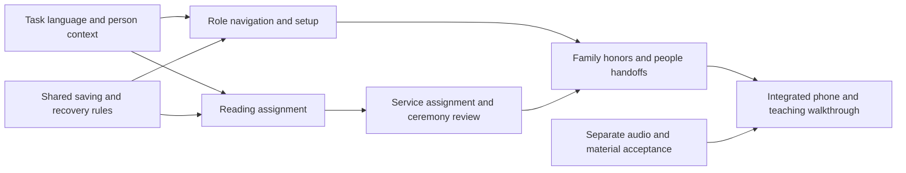

# Recommended order of product work

Consultant recommendation • 18 October 2026 • Outcome roadmap, not engineering assignments, delivery dates or implementation authorization.

Start with the confusing assignment journey Daniel reported, then make the same simplicity consistent across roles. Do not begin with spacing, colors or a wholesale visual redesign. The greatest benefit comes from reducing decisions users should not have to make.

## Priority and sequence

| Order | Outcome | Findings | Scope and relative change | Acceptance evidence |
| --- | --- | --- | --- | --- |
| 1. Assign readings intuitively | Staff can choose an appropriate passage using the date already present, familiar choices and one meaningful review. | UX-03; informs UX-04, UX-15 | Focused journey redesign. Evaluate the existing undeployed candidate against the full journey; do not assume selectors alone finish it. | Daniel assigns Torah and haftarah, a custom multi-range passage and an afternoon service without reference syntax coaching; verifies exactly what saved. |
| 2. Make place and next action obvious | Students practice immediately; parents see the selected child's preparation; staff stay in a student's context. | UX-01, UX-02, UX-05, UX-06, UX-09 | Cross-product structural work. Establish identity, navigation and action labels once; adapt by role. Preserve the incumbent visual direction. | From any major destination Daniel identifies current person/role, finds the next task and returns without losing context. |
| 3. Make work dependable | Forms protect unfinished effort, saving is clear and uncertainty has one safe next step. | UX-10, UX-11; applies throughout | A shared behavioral standard across existing forms; prioritize contact, assignment and honors work. Consequential reviews remain. | Closing a changed form never silently discards work during controlled navigation. Interrupted saves are understood without blind resubmission. |
| 4. Finish the administrative journey | Student creation, reading assignment, tutors and access form an understandable setup sequence. | UX-15, UX-16, UX-17 | Connect existing management tasks; explain contact vs invitation vs effective access; improve import review and exceptions. | Daniel can identify every incomplete setup item, invite the intended person and explain the scope of an access removal before confirming. |
| 5. Make family and ceremony preparation manageable | Families complete honors in sections, reuse names and understand blessing-link readiness. | UX-12, UX-13, UX-14, UX-19 | Family task organization plus specific guest recovery language. Adult authority remains a separate policy decision. | Family work can pause/resume; date/aliyah changes are understandable; a permitted guest can recover after an app switch. |
| 6. Make learning depth and handoffs coherent | Service assignment, word/source tools, translation, lesson notes and printed outputs use the same task language. | UX-04, UX-07, UX-08, UX-18 | Contextual refinement and completion of required operational journeys. Do not turn missing capabilities into cosmetic placeholders. | A teacher assigns a service part/source, a student finds it, and each can explain which text is theirs and what is saved. Available outputs identify their scope/version. |
| 7. Verify the whole experience | Revised 1.0 is complete, usable and eligible for Daniel's release decision. | All | Integrated evaluation against the inventory and validation plan. Actual-device checks are required evidence, not implied by screenshots. | Daniel completes the core scenarios on an actual phone and teaching device; later novice evaluation occurs only when permitted. |

These are priorities, not a requirement to finish all of one column before noticing a serious problem elsewhere. Apply the shared save/recovery standard to the first journey. **UX-14 must be addressed and validated before real honoree activation**, even if other family improvements remain scheduled later. Likewise, source/listening acceptance remains a prerequisite for student audio release, regardless of the order of visual work.

Relative change describes product breadth, not developer effort or a time estimate. There is insufficient validated implementation scope to promise dates or a budget.

## Dependencies that shape the sequence

Reorganization should first specify the complete task and its states, then arrange the screens. A new tab or dropdown is useful only if it helps a user make a clearer decision. The assigned student, current passage, ceremony and access consequences must survive movement between screens.

## Product completeness is a separate workstream

The current product has substantial released foundations, but the full revised 1.0 cannot be called complete. The [inventory](INVENTORY.md#requirements-without-a-complete-ordinary-journey-located) records required or anticipated journeys without a complete usable surface. They need explicit disposition alongside usability work:

| Category | Required disposition |
| --- | --- |
| Student reference listening | Complete Daniel's actual-source timing/listening and phone acceptance before changing availability. |
| Honoree blessings | Complete the separately approved material activation and guest experience checks. Deployed controls and an empty material store are not a usable recipient journey. |
| Maven, owned Sheet, MCP | Establish the actual operating workflow, source of truth, reconciliation, authority and successful handoff. Do not claim live synchronization from local groundwork. |
| Congregation settings/onboarding | Define the minimum usable administrator journey already in approved scope, without designing a broad multi-congregation platform. |
| Learning/print breadth | Reconcile the confirmed requirements for tikkun, personalized practice sheets and reference tools against the actual supported subset. Separate firm release requirements from historical ideas or desirable extensions. |
| Adult honors | Decide the responsibility/permission policy explicitly. Until then, give adults an honest authorized path for supplying information. |

Generated chant, student recording upload, offline/PWA and notification extras remain outside the revised 1.0 priority. Do not use the UX review to restart parked work. Custom packet/siddur generation and general family logistics are not additions to this roadmap.

## Ownership of decisions

The consultant owns recommended journeys, priorities, vocabulary and experience criteria. Daniel retains the existing product-policy and release decisions. Any future implementation owner should demonstrate the full journey against these criteria; completion is not established by a merged control or a passing component test.

The following are genuine unresolved matters, not reasons to pause this analysis: adult honors responsibility, real material/source availability, operational integration ownership, and Daniel's release acceptance. Navigation order, default destinations, progressive disclosure and ordinary labels have been recommended here without asking Daniel to design the product himself.

## Handoff rule

When implementation is later authorized, scope the first assignment to the reading journey and its connected states. Use [INFORMATION-ARCHITECTURE.md](INFORMATION-ARCHITECTURE.md), UX-03, and validation scenarios V03–V04 as the acceptance brief. Compare the existing candidate to that brief before commissioning replacement work. Preserve its evidence as historical, and do not merge or deploy it because it is mentioned in this review.
